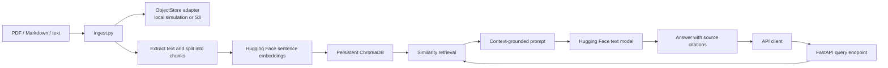

# Distributed Document RAG System

A cloud-native, document-grounded Q&A service with a command-line ingestion pipeline, an
S3-compatible storage boundary, persistent Chroma vector search, and a FastAPI
query endpoint. It runs locally with a filesystem-backed S3 simulation; switch
to the AWS S3 adapter with configuration when an AWS bucket is available.

## Architecture



## Layout

```text
distributed-rag/
├── rag_service/
│   ├── api.py             # HTTP query and health endpoints
│   ├── pipeline.py        # Parsing, indexing, retrieval and generation
│   └── storage.py         # Filesystem S3 simulation and boto3 adapter
├── k8s/
│   ├── deployment.yaml
│   └── service.yaml
├── tests/
│   └── test_storage.py
├── ingest.py              # Document ingestion CLI
├── query.py               # Question answering CLI
├── Dockerfile
└── requirements.txt
```

## Local setup

Python 3.11+ is recommended. PyTorch, embedding models, and the text generation
model are sizeable downloads; first startup requires model-registry access
unless the Hugging Face cache is pre-populated.

```powershell
cd projects/distributed-rag
py -3.11 -m venv .venv
.\.venv\Scripts\Activate.ps1
python -m pip install -r requirements.txt
```

Place `.pdf`, `.md`, or UTF-8 `.txt` files under a directory and ingest them:

```powershell
python ingest.py .\documents
python query.py "What is the document's refund period?"
```

The default filesystem object store is `./data/objects`; ChromaDB persists in
`./data/chroma`. Ingestion re-uploads each source key and replaces that
document's indexed chunks. Unsupported files are ignored. Invalid supported
files are logged and counted as skipped; the CLI exits unsuccessfully if any
file was skipped.

Run the API:

```powershell
uvicorn rag_service.api:app --host 0.0.0.0 --port 8000
```

```powershell
curl.exe -X POST http://localhost:8000/api/v1/query `
  -H "Content-Type: application/json" `
  -d '{\"question\":\"What is the document''s refund period?\"}'
```

Example response:

```json
{
  "answer": "The refund period is 30 days [policy.pdf, page 2].",
  "sources": [
    {
      "document": "policy.pdf",
      "page": 2,
      "relevance": 0.81
    }
  ]
}
```

## Configuration

| Variable | Default | Description |
|---|---|---|
| `STORAGE_BACKEND` | `local` | `local` for filesystem simulation or `s3` for AWS |
| `OBJECT_STORE_DIR` | `./data/objects` | Filesystem object-store root |
| `S3_BUCKET` | unset | Required for the S3 backend |
| `AWS_REGION` | AWS SDK default | Optional region for boto3 |
| `CHROMA_DIR` | `./data/chroma` | Persistent Chroma database directory |
| `CHROMA_COLLECTION` | `documents` | Chroma collection |
| `EMBEDDING_MODEL_ID` | `sentence-transformers/all-MiniLM-L6-v2` | Embedding model |
| `EMBEDDING_DEVICE` | `cpu` | Embedding inference device |
| `GENERATION_MODEL_ID` | `google/flan-t5-base` | Local text-generation model |
| `RETRIEVAL_TOP_K` | `4` | Maximum retrieved chunks |
| `RETRIEVAL_SCORE_THRESHOLD` | `0.25` | Minimum relevance score |

For S3, set `STORAGE_BACKEND=s3` and `S3_BUCKET`, then provide credentials
through the standard AWS credential chain (IAM role, profile, or environment).
Do not place AWS keys in source code or Kubernetes manifests.

## Kubernetes

Build the image and make it available to the cluster, then apply the manifests:

```powershell
docker build -t distributed-rag:latest .
kubectl apply -f k8s/
kubectl port-forward service/distributed-rag 8080:80
```

The manifest includes a single-replica deployment and a persistent volume claim
for the local object simulation, vector index, and model cache. It is a
development deployment: do not scale local Chroma or filesystem storage across
replicas. For a multi-replica deployment, use shared object storage and a
production vector database, manage credentials with Kubernetes secrets or
workload identity, and configure resource sizing for the selected models.

## API

| Method | Path | Description |
|---|---|---|
| `GET` | `/health/live` | Liveness probe |
| `GET` | `/health/ready` | Readiness probe after model and vector store initialization |
| `POST` | `/api/v1/query` | JSON body `{"question":"..."}` |
| `GET` | `/docs` | OpenAPI UI |

The model is instructed to answer only from retrieved context. A relevance
threshold can return an explicit no-match answer instead of asking the model to
guess. This is not a guarantee of factuality; validate answers and citations
before using them for high-impact decisions.

The sample stores source documents and derived embeddings without application
level encryption or authentication. Use non-sensitive demonstration documents
locally. A production deployment should add authenticated access, encryption,
tenant isolation, retention/deletion workflows, and request quotas.

## Tests

```powershell
python -m pip install -r requirements-dev.txt
python -m pytest -q
```
